# Infer — Phase 1 Component Design Catalogue

**Status:** Proposed detailed design  
**Version:** 0.1  
**Date:** 2026-11-26  
**Scope:** Components defined by [Phase 1 MVP Design](PHASE_1_MVP_DESIGN.md)  
**Parent:** [Reference Architecture](REFERENCE_ARCHITECTURE.md)

> This document expands the Phase 1 component boundaries into implementation-level responsibilities, interfaces, lifecycles, comic-style explanations, activity diagrams and flowcharts. The diagrams are design aids, not claims that the implementation already exists. Any API sketch remains provisional until the pinned ggml revision and HIP capabilities are verified.

## 1. How to read this catalogue

Each component has the same structure:

1. **Purpose and responsibility** — why it exists and what it owns.
2. **Detailed design** — inputs, outputs, internal behavior, state, dependencies and failure behavior.
3. **Comic strip** — a short visual analogy for the component's role.
4. **Activity diagram** — the component's behavior over time, including decisions.
5. **Flowchart** — its main processing path and failure exits.
6. **Verification** — the tests that demonstrate its contract.

### 1.1 Phase 1 component inventory

| ID | Component | Primary responsibility |
|---|---|---|
| C01 | CLI and application composition | User commands, configuration and process composition |
| C02 | Infer core and request lifecycle | Model-neutral request and generation event contract |
| C03 | Model contract and registry | Adapter discovery, probing and capability validation |
| C04 | Fixture model adapter | Deterministic model-neutral test workload |
| C05 | Single-request scheduler | Admission, cancellation and request sequencing |
| C06 | Runtime, planner and executor | Plan validation, backend binding and graph execution |
| C07 | Device and backend port | Device discovery, selection and capability reporting |
| C08 | Safe ggml Rust wrapper | Safe ownership of native contexts, buffers, graphs and events |
| C09 | Raw FFI crate | Opaque C ABI declarations and unsafe boundary |
| C10 | Native C ABI bridge and ggml/HIP | Adapt pinned native backend APIs to the stable C boundary |
| C11 | Observability and diagnostics | Structured events, metrics, provenance and run manifest |
| C12 | Phase 1 allocation accounting | Track Infer-owned GPU allocations and safety reserve |

C12 is shown separately because allocation accounting is a cross-cutting runtime capability. It is deliberately not the complete Phase 2 memory coordinator.

### 1.2 Dependency map

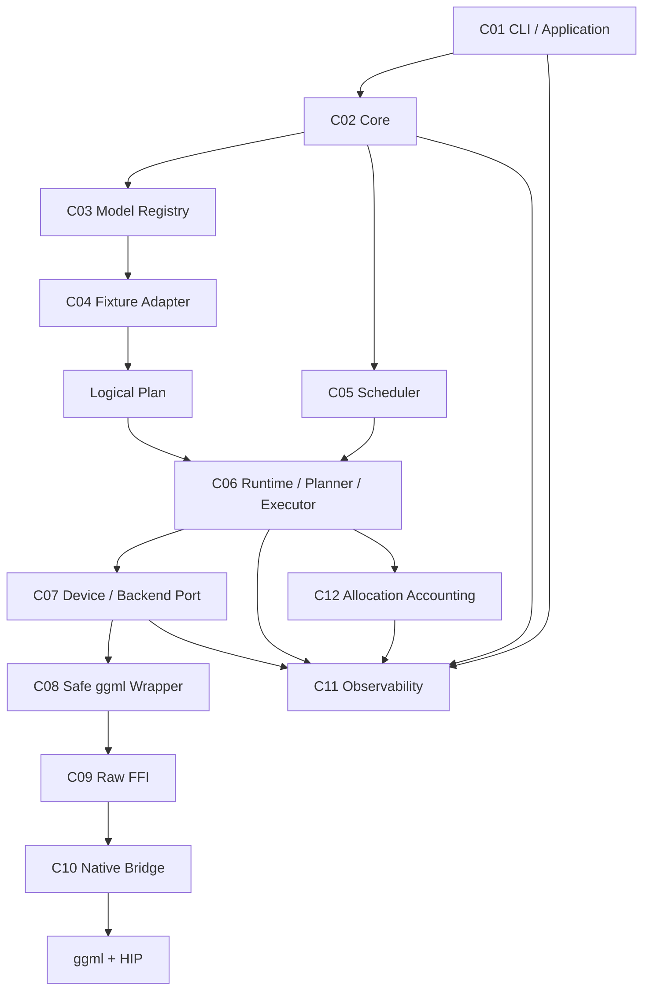

**Dependency rule:** dependencies point toward stable contracts. Model and product logic never receives a HIP handle or raw ggml pointer. Native implementation details stay below the safe wrapper.

---

# C01 — CLI and application composition

## Purpose

Provide the operator-facing command line and compose the application. It translates user intent into validated configuration and core operations, then renders results. It is not the inference engine itself.

## Detailed design

### Responsibilities
- Parse commands and arguments.
- Load the versioned TOML configuration.
- Apply precedence: built-in defaults → config file → environment overrides (only documented keys) → CLI arguments.
- Validate the effective configuration before initializing native resources.
- Construct dependencies in a known order.
- Route commands to application use cases.
- Render human-readable output and optional machine-readable JSON.
- Map structured errors to stable exit codes.
- Initiate orderly shutdown.

### Commands owned
- `doctor`: prerequisites, native build identity and device readiness.
- `devices`: enumerate devices.
- `config validate`: validate and display effective configuration.
- `model inspect`: metadata/probe only; never imply universal GGUF support.
- `test run`: execute fixture verification.
- `run`: submit one generation request and stream events.
- `benchmark`: repeat fixture workload and write a run record.

### Inputs and outputs
- Input: argv, config file, documented environment variables, stdin only if explicitly supported.
- Output: stdout for result/events, stderr for diagnostics, process exit code.
- Does not own: model weights, device buffers, graph handles, request scheduler state.

### Composition order
1. Parse syntax and command.
2. Load/merge config.
3. Validate static config (no GPU required).
4. Initialize logging and run identity.
5. Create native runtime through the runtime factory.
6. Discover/select device if the command needs it.
7. Construct registry, adapter, scheduler and runtime services.
8. Execute command.
9. Drain active work and dispose services in reverse dependency order.

Commands such as config validation should not initialize HIP. `devices`, `doctor`, `test`, `run` and `benchmark` may initialize native services.

### Error policy
- Syntax/config errors: non-zero exit before native initialization.
- Device/backend errors: actionable diagnostics; no silent CPU fallback.
- Request failure: render request ID and stable error code.
- Broken pipe: cancel request and perform safe drain.
- Ctrl-C: signal cancellation; do not free resources while GPU work remains in flight.

### Comic strip

```text
[Operator]       [CLI]              [Application]          [Runtime]
    |               |                     |                    |
    | "infer run"   |                     |                    |
    |-------------->| parse + config      |                    |
    |               |-------------------->| compose services   |
    |               |                     |------------------->|
    |               |                     |       run request  |
    |<-------------- streamed events / status -----------------|
    |               |                     |                    |
```

### Activity diagram

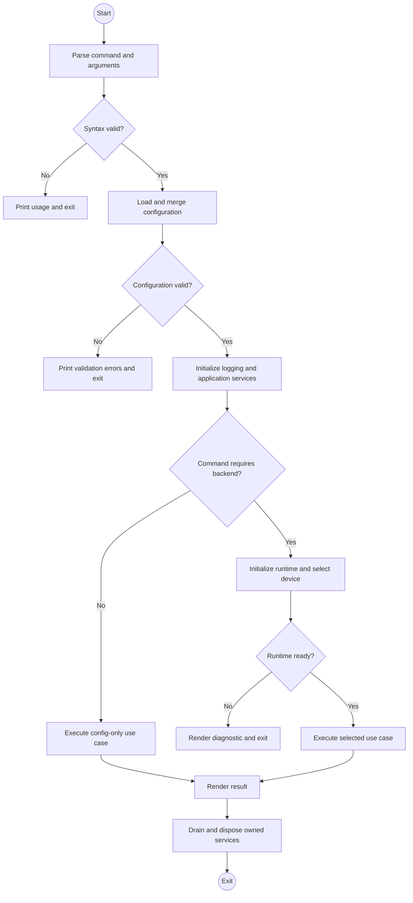

### Flowchart

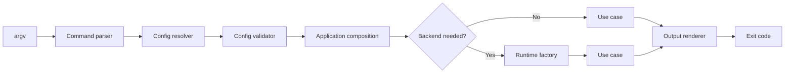

### Verification
- CLI parsing and config precedence tests.
- Config-only command works without ROCm installed.
- Invalid device never falls back silently.
- Ctrl-C and broken pipe trigger cancellation and safe shutdown.
- Exit codes are stable and documented.

---

# C02 — Infer core and request lifecycle

## Purpose

Own model-neutral request identity, request data, generation events and lifecycle semantics. This is the stable product contract between application transports and execution services.

## Detailed design

### Responsibilities
- Define request and model identifiers.
- Validate request-level limits (non-empty prompt where required, max output bound, supported options).
- Track request lifecycle and terminal status.
- Publish ordered generation events.
- Ensure exactly one terminal event per request.
- Propagate cancellation without assuming that submitted GPU work has stopped.
- Keep transport details out of the core.

### Request state machine

```text
Created -> Validating -> Planned -> Queued -> Running
                                         |       |
                                         |       +-> Cancelling -> Cancelled
                                         |       +-> Completed
                                         |       +-> Failed
                                         +-> Rejected
```

Terminal states are Completed, Cancelled, Failed and Rejected. A request cannot transition out of a terminal state.

### Request contract
Conceptual API:

```rust
pub struct GenerationRequest {
    pub request_id: RequestId,
    pub model_id: String,
    pub prompt: String,
    pub max_new_tokens: u32,
}

pub enum GenerationEvent {
    Started { request_id: RequestId },
    PrefillCompleted { elapsed: Duration },
    Token { token_id: u32, text: String },
    Metrics(GenerationMetrics),
    Completed,
    Cancelled,
    Failed(InferError),
}
```

The actual event channel should be bounded. Backpressure must be explicit: the producer may await capacity or terminate a disconnected consumer by cancelling the request. Do not buffer unbounded token events in memory.

### Invariants
- Request ID is unique for the process lifetime.
- Event order is deterministic.
- No token event is emitted after a terminal event.
- Exactly one terminal event is emitted.
- Cancellation is idempotent.
- Cancellation does not release backend resources; executor completion is required.
- Prompt logging is opt-in and off by default.

### Detailed behavior
1. Accept request from application.
2. Allocate request ID if caller did not supply one.
3. Validate limits and model reference.
4. Create cancellation token and bounded event channel.
5. Transition to Planned/Queued/Running as delegated stages complete.
6. Forward execution events in order.
7. On cancellation, request scheduler stop and await safe completion.
8. Emit terminal event once and close channel.

### Comic strip

```text
[Client]             [Core Request]              [Executor]
   |                       |                         |
   | submit prompt         |                         |
   |---------------------->| create request ID       |
   |                       |------------------------>|
   |                       |                         | work
   |<----------------------| Token("Hello")           |
   |<----------------------| Token(" world")          |
   | Cancel                |                         |
   |---------------------->| mark cancellation       |
   |                       |------------------------>|
   |                       |                         | finish in-flight GPU work
   |<----------------------| Cancelled (terminal)    |
```

### Activity diagram

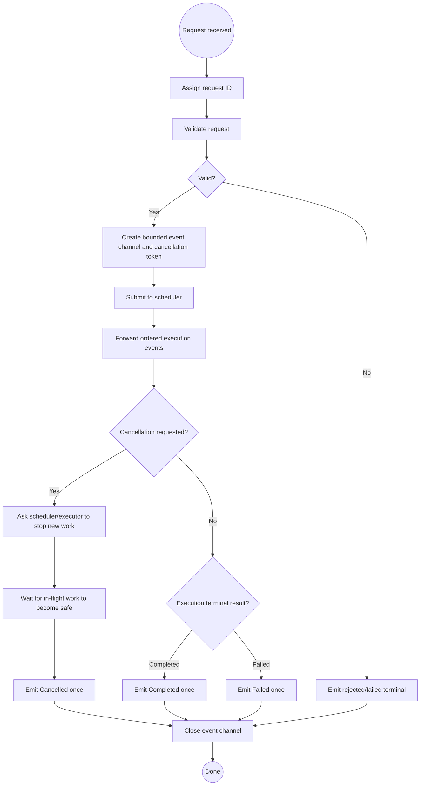

### Flowchart

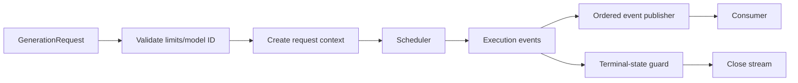

### Verification
- Property/state-transition tests.
- Exactly-one-terminal-event tests.
- Bounded-channel backpressure tests.
- Cancellation before planning, while queued and during execution.
- Consumer disconnect cancellation.
- No prompt text in logs by default.

---

# C03 — Model contract and registry

## Purpose

Provide a model-family-independent way to identify an adapter, probe metadata, expose supported capabilities and create a logical execution plan.

## Detailed design

### Responsibilities
- Register compiled-in adapters by stable architecture ID.
- Resolve a requested adapter/model identity.
- Probe model metadata and return Supported, Unsupported or NeedsInspection.
- Validate required model capabilities against adapter support.
- Ask the adapter to build a logical plan.
- Keep model metadata parsing separate from backend execution.

### Registry policy
Phase 1 uses compile-time registration. Dynamic shared-library plugins are explicitly out of scope. Duplicate IDs are startup errors. Registry lookup must be deterministic.

### Probe result
A probe must explain its decision:
- Supported: metadata is understood within adapter scope.
- Unsupported: architecture or required feature is not implemented.
- NeedsInspection: metadata is incomplete or ambiguous.
Never guess architecture from a filename alone.

### Adapter contract
Conceptual API:

```rust
pub trait ModelAdapter: Send + Sync {
    fn id(&self) -> ModelArchitectureId;
    fn probe(&self, metadata: &ModelMetadata) -> ProbeResult;
    fn capabilities(&self) -> ModelCapabilities;
    fn build_plan(
        &self,
        metadata: &ModelMetadata,
        request: &ModelRequest,
    ) -> Result<LogicalExecutionPlan, InferError>;
}
```

### Detailed flow
1. Receive model metadata and optional adapter ID.
2. If adapter ID is explicit, resolve exactly that adapter.
3. Otherwise ask registered adapters to probe metadata.
4. Reject zero matches or ambiguous multiple matches.
5. Validate model features against declared adapter capabilities.
6. Build logical plan.
7. Validate plan shape and return it to runtime.
8. Registry never allocates device memory or initializes a backend.

### Comic strip

```text
[Model Metadata]     [Registry]          [Adapter]
      |                  |                   |
      | "architecture?"  |                   |
      |----------------->| ask registered    |
      |                  |------------------>|
      |                  |                   | inspect metadata
      |                  |<------------------|
      |                  | Supported / reason|
      |<-----------------| selected adapter  |
```

### Activity diagram

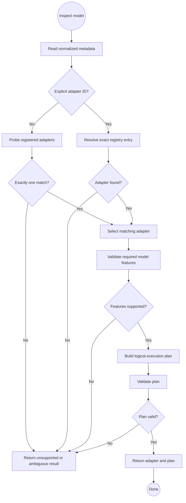

### Flowchart

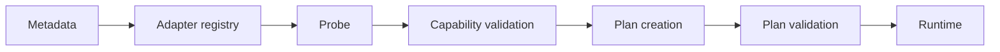

### Verification
- Unknown and duplicate adapter IDs.
- No match and ambiguous match behavior.
- Unsupported feature diagnostics.
- Registry deterministic resolution.
- Plan construction has no backend dependency.

---

# C04 — Fixture model adapter

## Purpose

Provide a deterministic workload that proves the model adapter and runtime contracts before a production architecture is implemented. It is a test instrument, not a language model.

## Detailed design

### Responsibilities
- Expose a stable fixture adapter ID such as `fixture.dense.v1`.
- Describe a small operation graph using operations known to be supported by the pinned ggml HIP backend.
- Define deterministic input tensors and expected outputs.
- Provide a CPU/reference implementation for numerical comparison.
- Produce a deterministic sequence of token-like events for request lifecycle testing.

### Fixture requirements
- Tiny bounded tensor sizes.
- No external model download.
- Stable seed and test data.
- Explicit datatype and numerical tolerance.
- The graph must be selected only after validating operation support on the pinned native revision.
- Fixture generation must be labelled as synthetic; never present it as model-quality inference.

### Suggested logical workload
A small deterministic dense graph, for example input projection → activation → output projection, subject to supported operation availability. Avoid inventing custom kernels solely to fit the fixture.

### Comic strip

```text
[Test Runner]       [Fixture Adapter]        [Reference]       [HIP Backend]
     |                     |                    |                   |
     | build test plan     |                    |                   |
     |-------------------->| describe graph     |                   |
     |                     |------------------->| expected result   |
     |                     |--------------------------------------->|
     |                     |                    |             execute|
     |<--------------------| compare result <-----------------------|
     | PASS / FAIL          |                    |                   |
```

### Activity diagram

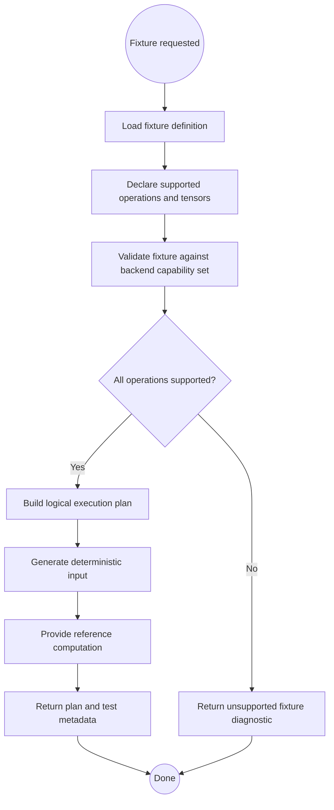

### Flowchart

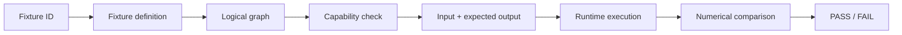

### Verification
- Stable plan hash for unchanged fixture version.
- Reference output deterministic.
- GPU output within documented tolerance.
- Unsupported operations fail before graph submission.
- Synthetic token events are visibly identified as fixture output.

---

# C05 — Single-request scheduler

## Purpose

Control admission and lifecycle sequencing for the Phase 1 single-active-request execution model. It is a product-level request scheduler, not a replacement for the ggml graph scheduler.

## Detailed design

### Responsibilities
- Accept one active request and maintain a bounded pending state (default policy: reject or wait; choose one explicit CLI behavior).
- Enforce single active model/session constraints.
- Apply cancellation and output limits.
- Sequence prefill/execute/decode steps as exposed by runtime.
- Coordinate terminal status with core.
- Ensure request-owned resources are released only after executor completion.

### Non-responsibilities
- Kernel scheduling.
- Tensor placement inside ggml graphs.
- Multi-GPU load balancing.
- Continuous batching or multi-tenant fairness.
- KV eviction or expert-cache policy.

### State
- Idle
- Admitting
- Running
- Cancelling
- Draining
- Idle after terminal cleanup

Only one request may be Running in Phase 1. If a second request arrives, behavior must be explicit: return Busy or wait in a bounded queue. Do not allow an unbounded queue.

### Admission policy
Initial recommendation: reject concurrent submissions with a structured Busy response. This makes memory and correctness behavior deterministic. A bounded waiting queue can be introduced only with a concrete use case.

### Comic strip

```text
[Request A]        [Scheduler]          [GPU Executor]       [Request B]
    |                  |                     |                   |
    | submit           |                     |                   |
    |----------------->| admit A             |                   |
    |                  |-------------------->| execute A         |
    |                  |<--------------------|                   |
    |                  | B arrives                               |
    |                  |<-----------------------------------------|
    |                  | Busy (single active request)             |
    |                  |----------------------------------------->|
    |<-----------------| A completed                              |
```

### Activity diagram

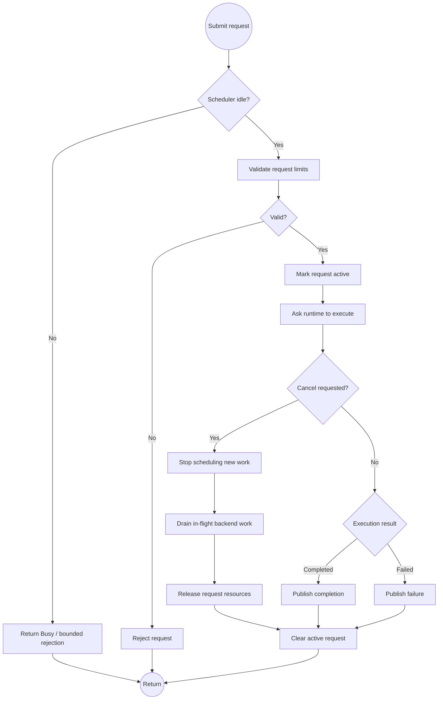

### Flowchart

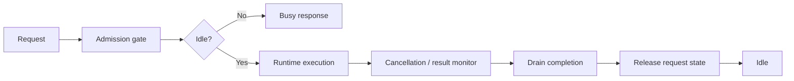

### Verification
- Simultaneous request test: exactly one admitted.
- Busy behavior stable and documented.
- Cancellation in each scheduler state.
- No request resource released before completion fence.
- Scheduler returns to Idle after success and failure.

---

# C06 — Runtime, planner and executor

## Purpose

Turn a validated model-neutral logical plan into executable backend work. This is the central orchestration layer between model adapters and device/backend implementations.

## Detailed design

### Responsibilities
- Validate plan requirements against backend capabilities.
- Convert logical operations into the selected backend graph representation.
- Manage graph construction and submission.
- Associate buffers and resources with graph lifetime.
- Track asynchronous completion through events/fences.
- Return structured execution results and timing.
- Coordinate allocation accounting.
- Never parse model files or contain architecture-specific math.

### Internal subcomponents
- **Runtime:** owns initialized backend and execution services.
- **Planner:** checks operation/capability requirements and creates a backend execution plan.
- **Executor:** submits the plan and observes completion.
- **Completion tracker:** associates submitted work with buffers and graph handles until safe release.

Keep these as modules/types initially, not independent services.

### Execution lifecycle
1. Receive logical plan.
2. Validate operation set, datatype and resource requirements.
3. Ask backend to create required graph/buffers.
4. Reserve Phase 1 allocation budget.
5. Submit graph.
6. Receive completion handle.
7. Await/query completion without unnecessary device-wide synchronization.
8. Collect result and timings.
9. Release graph/buffer owners after completion.
10. Reconcile allocation accounting.

### Asynchronous safety
A successful submit means work is queued, not complete. The executor must keep every referenced buffer and graph alive until the completion fence signals. Cancellation prevents future submissions; it does not invalidate already-submitted work.

### Comic strip

```text
[Adapter]          [Planner]          [Executor]          [GPU]
    |                  |                  |                 |
    | logical plan     |                  |                 |
    |----------------->| check support   |                 |
    |                  |---------------->| submit graph    |
    |                  |                  |---------------->|
    |                  |                  |   queued work   |
    |                  |                  |<----------------|
    |                  |                  | completion event|
    |<-----------------| result + metrics |                 |
```

### Activity diagram

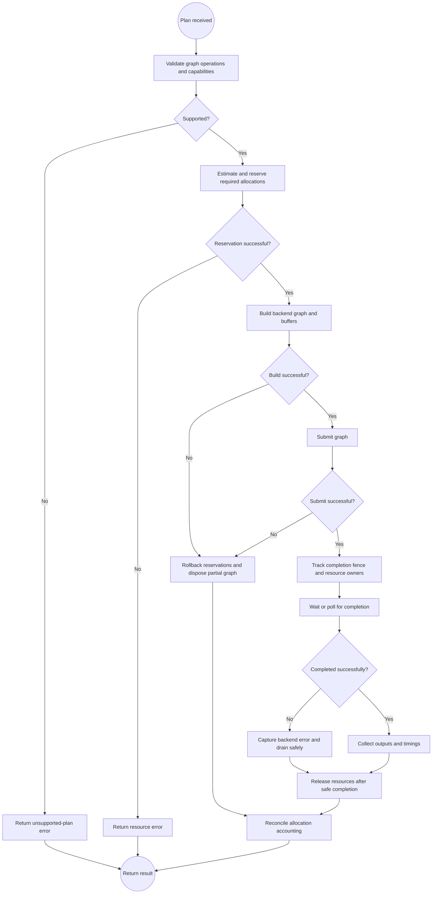

### Flowchart

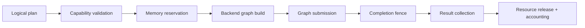

### Verification
- Plan rejection before allocation.
- Reservation rollback for partial failure.
- Asynchronous completion keeps buffers alive.
- No device-wide sync in ordinary per-operation flow unless required by backend API.
- Execution result matches reference.
- Errors preserve enough context for diagnostics.

---

# C07 — Device and backend port

## Purpose

Expose a model-neutral compute device interface to the runtime. Phase 1 implements ggml/HIP on the RX 9070; the port prevents product logic from depending directly on HIP or ggml-specific types.

## Detailed design

### Responsibilities
- Initialize backend implementation.
- Enumerate available devices.
- Expose stable device identity, architecture, memory observations and supported capabilities.
- Select the explicitly requested device.
- Provide backend operations needed by planner/executor.
- Report backend/runtime version and build capabilities.

### Device selection
Selection should prefer a stable identity supplied by backend where available. Name and ordinal are useful diagnostics but may not be unique or stable across environment changes. Architecture must be validated independently. Phase 1 requires RX 9070 / gfx1201 for the target acceptance environment.

### Port surface
Conceptual operations:
- enumerate devices;
- select device;
- query capabilities;
- create buffer;
- build/submit graph;
- query/wait completion;
- release resources;
- query memory observations.

Avoid a huge universal backend trait. Define only operations needed by Phase 1. Use typed backend-specific implementation behind the port.

### Capability reporting
Capabilities must be measured or reported by the selected backend, not inferred from product-name strings. Represent unknown information as unavailable rather than false or zero.

### Comic strip

```text
[Runtime]         [Backend Port]          [HIP Backend]         [GPU]
    |                  |                       |                 |
    | list devices     |---------------------->| enumerate       |
    |                  |<----------------------| RX 9070/gfx1201 |
    | select target    |---------------------->| select device   |
    |                  |                       |---------------->|
    |                  |<----------------------| ready/capability|
    |<-----------------| DeviceInfo            |                 |
```

### Activity diagram

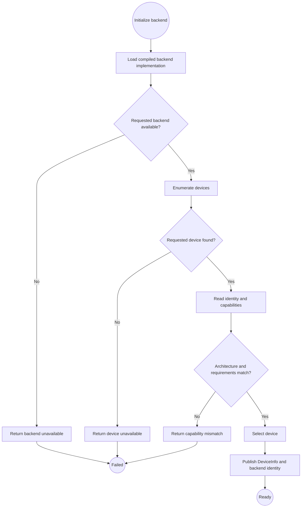

### Flowchart

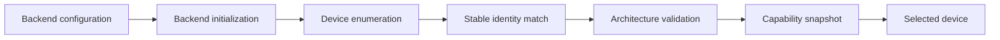

### Verification
- No backend compiled / unavailable behavior.
- Device not found and architecture mismatch behavior.
- Device inventory deterministic in tests using a fake backend.
- RX 9070 identity and gfx1201 verified on target machine.
- Capability values and unknown fields handled correctly.

---

# C08 — Safe ggml Rust wrapper

## Purpose

Provide ergonomic, ownership-safe Rust types over the raw C ABI. This is the only layer most Rust runtime code should use to interact with native ggml resources.

## Detailed design

### Responsibilities
- Wrap opaque native handles in RAII owners.
- Validate Rust inputs before crossing FFI.
- Convert native status codes into typed Rust errors.
- Expose typed device, buffer, graph and event APIs.
- Enforce lifetimes and completion dependencies.
- Keep unsafe code minimal and localized.

### Ownership model
- Runtime/context owns backend-level state.
- Device handle is a view owned by runtime unless native API requires a separate owner.
- Buffer owner retains the runtime/context dependency.
- Graph owner retains references/ownership to buffers it uses.
- Submission produces a completion owner retaining graph and buffers until completion.
- Drop must not free resources still used by submitted GPU work.

Prefer borrowing and explicit owner objects. Avoid `Clone` for native owners unless native reference counting semantics are implemented and tested.

### Threading
Do not mark wrappers Send/Sync by assumption. Add these traits only after confirming the native API's thread-safety and synchronization rules. The single-request scheduler does not imply every native handle is safe to use concurrently.

### Error conversion
C ABI status codes map to stable Rust errors. Native error strings are copied into owned Rust strings with bounded length. Never keep borrowed C string pointers beyond the call unless their lifetime is explicitly guaranteed.

### Comic strip

```text
[Runtime Rust]       [Safe Wrapper]        [Opaque Native Handle]
     |                     |                         |
     | create buffer       |                         |
     |-------------------->| validate + call         |
     |                     |------------------------>|
     |                     |<------------------------|
     |<--------------------| Buffer owner             |
     |                     |                         |
     | drop owner          | destroy exactly once    |
     |-------------------->|------------------------>|
```

### Activity diagram

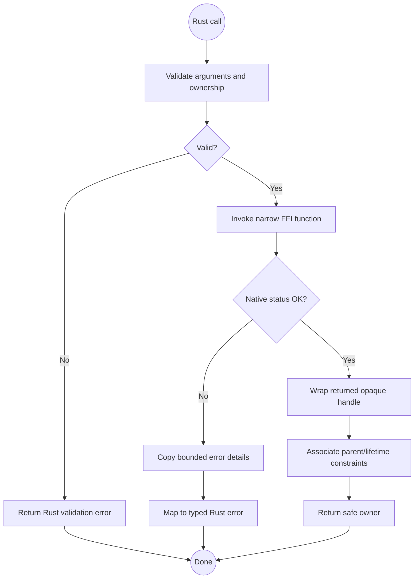

### Flowchart

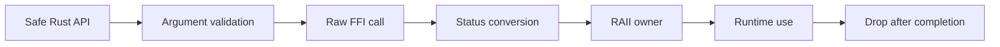

### Verification
- Drop exactly once.
- Parent context cannot be destroyed while child resources are live.
- Graph completion retains buffer lifetime.
- Null/invalid native results become Rust errors.
- Miri/unit-test any Rust-only unsafe assumptions where applicable; native integration tests cover actual handles.
- Thread-safety traits are withheld until proven.

---

# C09 — Raw FFI crate

## Purpose

Declare the C ABI accurately and provide the narrowest possible unsafe boundary. It is an implementation detail, not a general application API.

## Detailed design

### Responsibilities
- Declare opaque C handle types.
- Declare `repr(C)` structures matching the bridge header.
- Declare status codes and extern functions.
- Provide build/link metadata required by Rust.
- Contain raw pointer conversions and unsafe calls.

### Rules
- No business logic.
- No model types.
- No async runtime or scheduler dependency.
- No C++ types or C++ ABI.
- No unbounded strings or pointer ownership ambiguity.
- Keep generated bindings optional; hand-written bindings are acceptable for a small stable header if layout tests exist.

### ABI versioning
Expose API version and struct size. The bridge validates caller struct sizes before reading fields. Incompatible versions fail explicitly.

### Pointer contract
Every pointer parameter documents:
- nullable or non-null;
- input/output/in-out;
- valid duration;
- ownership transfer or borrowed-only;
- required alignment;
- maximum buffer length.

### Comic strip

```text
[Safe Wrapper]          [Raw FFI]             [C ABI]
      |                     |                    |
      | typed call          | raw pointer call   |
      |-------------------->|------------------->|
      |                     |<-------------------|
      | typed result        | status + handle    |
      |<--------------------|                    |
      |                     |                    |
      | "unsafe stays here" |                    |
```

### Activity diagram

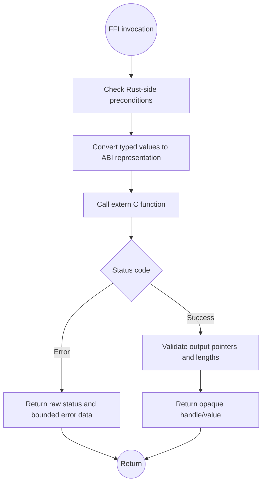

### Flowchart

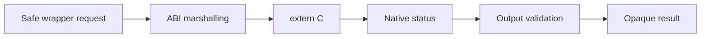

### Verification
- ABI struct size/alignment tests on target.
- API version mismatch test.
- Null pointer and invalid length tests.
- Status-code mapping coverage.
- No C++ exception crosses boundary.
- No Rust panic crosses into native code.

---

# C10 — Native C ABI bridge and ggml/HIP

## Purpose

Adapt the selected, pinned ggml/llama.cpp backend APIs into a small stable C ABI that Rust can consume. The bridge is the containment boundary for C++ and native backend volatility.

## Detailed design

### Responsibilities
- Initialize and destroy the selected ggml backend/runtime.
- Enumerate devices and report identity/capabilities.
- Create buffers and graph objects required by the Phase 1 fixture.
- Submit graph work and expose completion state.
- Translate native errors to status codes and bounded diagnostics.
- Catch all C++ exceptions.
- Keep patch surface small and traceable to upstream revision.

### Native source strategy
- Pin an exact ggml/llama.cpp commit SHA.
- Build required ggml libraries with HIP support and gfx1201 target configuration validated on the target system.
- Keep bridge source under `native/ggml-bridge`.
- Avoid copying/forking large upstream trees without a demonstrated reason.
- Keep any required patch isolated, documented and testable.

### C ABI design
Opaque handles only:
- runtime;
- device;
- buffer;
- graph;
- event/completion.

Use plain fixed-width integer types and explicit struct sizes. Return status codes. Provide a bounded error query. Do not expose C++ templates, classes, STL containers, exceptions or backend-specific pointer types.

### Async semantics
A graph submission call returning success means the work was accepted, not completed. Completion must be observed through an event/fence or equivalent backend primitive. The bridge must not perform an implicit global device synchronization after every operation unless the selected backend API requires it and the limitation is documented.

### Error and cleanup
- All exported functions validate arguments.
- All exported functions catch C++ exceptions.
- Partial construction uses local RAII cleanup before returning failure.
- Destroy functions are idempotent only if explicitly designed that way; otherwise wrapper ownership guarantees exactly-once destruction.
- Native error strings are bounded and copied, not returned as ephemeral pointers.

### Comic strip

```text
[Rust FFI]          [C ABI Bridge]          [ggml Backend]          [HIP]
    |                     |                       |                   |
    | infer_graph_submit  |                       |                   |
    |-------------------->| adapt stable call     |                   |
    |                     |---------------------->| build/submit      |
    |                     |                       |------------------>|
    |                     |                       |<------------------|
    |                     |<----------------------| event/status      |
    |<--------------------| status + opaque event |                   |
```

### Activity diagram

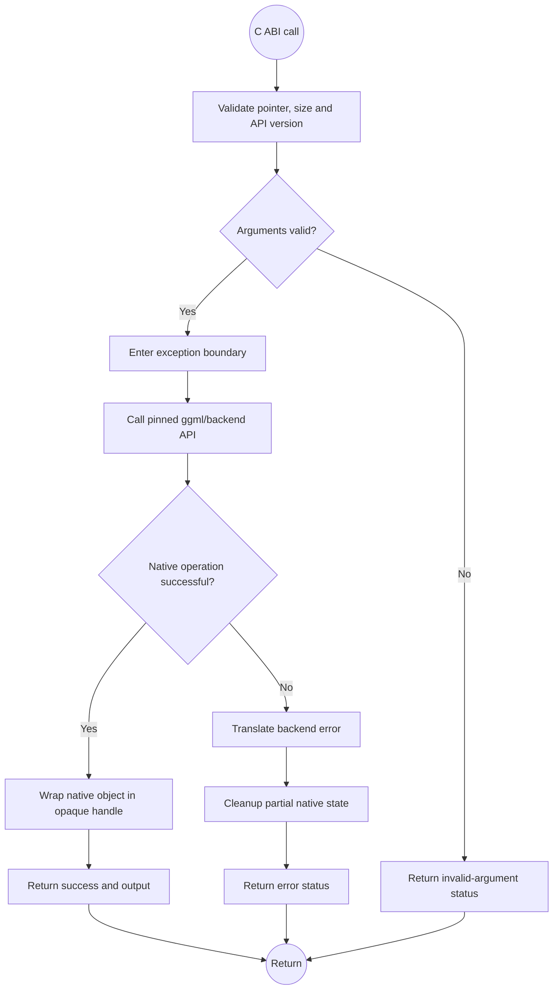

### Flowchart

```mermaid
flowchart LR
    A[C ABI request] --> B[Validate ABI contract]
    B --> C[Bridge adapter]
    C --> D[ggml backend API]
    D --> E[HIP execution]
    E --> F[Native event/result]
    F --> G[Translate to C status/handle]
```

### Verification
- Build reproducibility from pinned revision.
- C ABI lifecycle tests.
- HIP device enumeration and graph execution.
- Exception containment.
- Invalid arguments and partial failure cleanup.
- Async completion and no premature object destruction.
- Patch review confirms no unrelated upstream changes.

---

# C11 — Observability and diagnostics

## Purpose

Make every Phase 1 execution understandable and reproducible. Observability reports what happened; it must not secretly change scheduling or allocation policy.

## Detailed design

### Responsibilities
- Initialize structured logging.
- Correlate events with request ID and run ID.
- Collect startup, device, graph, prefill and decode timings.
- Record backend/device/runtime/build provenance.
- Track request outcomes and allocation counters.
- Emit a JSONL run manifest for tests and benchmarks.
- Distinguish unavailable measurements from zero.

### Event schema
Minimum fields:
- timestamp;
- level;
- event_name;
- component;
- run_id;
- request_id (when relevant);
- backend_id;
- device_id / architecture;
- elapsed_ns or duration;
- error_code (when relevant).

### Metrics
- startup duration;
- device discovery duration;
- graph build and execution duration;
- prefill and decode duration;
- emitted token-like item count;
- device total/free memory where available;
- Infer-owned live allocation bytes;
- reservation and allocation failures;
- request terminal status.

### Privacy
Prompt content is excluded by default. If diagnostic prompt logging is ever added, it must be explicit opt-in and clearly documented. No telemetry is sent over the network in Phase 1.

### Run manifest
Include Infer commit/dirty state, Rust version, OS/kernel, ROCm/HIP version, GPU identity, ggml revision, build flags, fixture/model identity/hash, config hash and workload parameters.

### Comic strip

```text
[Runtime]          [Observability]          [JSONL Record]       [Developer]
    |                     |                       |                  |
    | graph completed     |                       |                  |
    |-------------------->| add timing + IDs      |                  |
    |                     |---------------------->| append record    |
    |                     |                       |----------------->|
    |                     |                       |  inspect run     |
```

### Activity diagram

```mermaid
flowchart TD
    A((Runtime event)) --> B[Attach timestamp and correlation IDs]
    B --> C[Normalize event fields]
    C --> D{Sensitive prompt content?}
    D -- Yes --> E[Exclude or redact by default]
    D -- No --> F[Keep permitted fields]
    E --> G[Write structured log/metric]
    F --> G
    G --> H{Run record requested?}
    H -- Yes --> I[Append JSONL manifest/measurement]
    H -- No --> J[Continue]
    I --> J
    J --> K((Return))
```

### Flowchart

```mermaid
flowchart LR
    A[Component event] --> B[Correlation]
    B --> C[Structured logger]
    B --> D[Metrics collector]
    D --> E[Run manifest]
    C --> F[stderr/log file]
    E --> G[Benchmark artifact]
```

### Verification
- Required manifest fields present.
- Stable JSONL schema and parseability.
- Missing metrics represented as unavailable.
- Request correlation works across components.
- Prompt content absent from default logs.
- Observability failure does not corrupt request execution.

---

# C12 — Phase 1 allocation accounting

## Purpose

Track memory allocations owned by Infer during Phase 1 and prevent obvious over-budget allocations. This is an accounting and safety mechanism, not the Phase 2 tiered-residency coordinator.

## Detailed design

### Responsibilities
- Maintain a ledger for Infer-created device buffers.
- Record allocation ID, size, category, owner/request, creation time and lifecycle state.
- Maintain configured Infer VRAM budget and safety reserve.
- Reserve before native allocation; commit on success; roll back on failure.
- Release accounting only after the native resource is actually safe to destroy.
- Report Infer-tracked bytes separately from device-reported memory.

### Allocation categories
Phase 1 needs only a small category set such as:
- graph input/output;
- graph workspace;
- fixture/model buffer;
- backend staging (only if exposed by bridge).

Do not prematurely add expert, KV, recurrent state and PLE eviction policies; these are later resource types.

### Accounting invariants
- `reserved_bytes >= committed_live_bytes` only while reservations are outstanding; reconcile state after every transition.
- A failed allocation rolls back its reservation.
- A submitted graph's buffers remain accounted until completion and release.
- Device-reported free memory is an observation, not the Infer ledger.
- Unknown external/driver allocations are not attributed to Infer.

### Reservation flow
1. Receive requested bytes and category.
2. Validate size and overflow.
3. Check available Infer budget after safety reserve.
4. Create reservation token.
5. Perform native allocation.
6. Commit token on success or roll back on failure.
7. On safe release, decrement live allocation.
8. Emit accounting event.

### Comic strip

```text
[Executor]          [Allocation Ledger]       [HIP Allocator]
    |                       |                        |
    | need 256 MiB          |                        |
    |---------------------->| check budget           |
    |                       | reserve 256 MiB        |
    |                       |----------------------->|
    |                       |                        | allocate
    |                       |<-----------------------|
    |                       | commit allocation      |
    |<----------------------| buffer owner           |
    |                       |                        |
    | graph completion      | release after fence    |
    |---------------------->|----------------------->|
```

### Activity diagram

```mermaid
flowchart TD
    A((Allocation requested)) --> B[Validate size/category]
    B --> C{Valid?}
    C -- No --> X[Reject request]
    C -- Yes --> D[Compute budget remaining after reserve]
    D --> E{Budget sufficient?}
    E -- No --> Y[Return budget exceeded]
    E -- Yes --> F[Create reservation]
    F --> G[Call native allocator]
    G --> H{Allocation successful?}
    H -- No --> I[Rollback reservation]
    H -- Yes --> J[Commit live allocation record]
    J --> K[Return owned buffer]
    K --> L[Wait for all graph uses to complete]
    L --> M[Destroy native buffer]
    M --> N[Remove live record]
    N --> O((Done))
    I --> O
    X --> O
    Y --> O
```

### Flowchart

```mermaid
flowchart LR
    A[Requested bytes] --> B[Budget check]
    B --> C[Reservation token]
    C --> D[Native allocation]
    D --> E{Success?}
    E -- No --> F[Rollback]
    E -- Yes --> G[Commit ledger]
    G --> H[Use until completion]
    H --> I[Safe native release]
    I --> J[Ledger decrement]
```

### Verification
- Arithmetic overflow and invalid-size tests.
- Budget boundary and safety reserve tests.
- Allocation failure rolls back exactly once.
- In-flight graph buffers remain accounted.
- Reconciliation after repeated runs.
- Driver-reported memory and Infer ledger shown as separate values.

---

## 2. Cross-component request execution

This section ties the individual component contracts together into the Phase 1 vertical slice.

### 2.1 End-to-end activity diagram

```mermaid
flowchart TD
    A((CLI request)) --> B[C01: parse and validate config]
    B --> C[C07: initialize backend and select RX 9070]
    C --> D[C03: resolve model adapter]
    D --> E[C04: fixture probes metadata and builds plan]
    E --> F[C02: create request context and event stream]
    F --> G[C05: admit single request]
    G --> H[C06: validate and plan graph]
    H --> I[C12: reserve allocation budget]
    I --> J[C08/C09/C10: create and submit native graph]
    J --> K[HIP graph execution]
    K --> L[C06: observe completion and collect result]
    L --> M[C12: release and reconcile allocations]
    M --> N[C11: emit metrics and run manifest]
    N --> O[C02: publish terminal event]
    O --> P[C01: render result and exit]
```

### 2.2 End-to-end flowchart with failure exits

```mermaid
flowchart TD
    A[Start infer run] --> B[Parse and validate config]
    B -->|Invalid| E1[Config error]
    B --> C[Initialize and select backend device]
    C -->|Unavailable| E2[Device/backend error]
    C --> D[Resolve adapter and validate fixture]
    D -->|Unsupported| E3[Model/adapter error]
    D --> F[Create request and admit]
    F -->|Busy/invalid| E4[Request rejection]
    F --> G[Build and validate execution plan]
    G -->|Invalid| E5[Plan error]
    G --> H[Reserve and allocate resources]
    H -->|Failure| E6[Resource error + rollback]
    H --> I[Submit graph]
    I -->|Failure| E7[Backend error + safe cleanup]
    I --> J[Await completion]
    J -->|Cancelled| K[Drain and release]
    J -->|Failed| E8[Capture error and cleanup]
    J -->|Success| L[Collect output and metrics]
    L --> M[Release resources and reconcile]
    K --> N[Emit terminal event]
    E1 --> N
    E2 --> N
    E3 --> N
    E4 --> N
    E5 --> N
    E6 --> N
    E7 --> N
    E8 --> N
    M --> N
    N --> O[Write run record and render result]
    O --> P((Exit))
```

### 2.3 End-to-end sequence diagram

```mermaid
sequenceDiagram
    participant User
    participant CLI as C01 CLI
    participant Core as C02 Core
    participant Registry as C03 Registry
    participant Adapter as C04 Fixture
    participant Scheduler as C05 Scheduler
    participant Runtime as C06 Runtime
    participant Device as C07 Backend Port
    participant Safe as C08 Safe Wrapper
    participant FFI as C09 FFI
    participant Native as C10 Bridge / HIP
    participant Memory as C12 Ledger
    participant Obs as C11 Observability

    User->>CLI: infer run --fixture tiny-dense
    CLI->>Device: initialize and select device
    Device-->>CLI: RX 9070 / gfx1201
    CLI->>Registry: resolve fixture adapter
    Registry->>Adapter: probe + build plan
    Adapter-->>Registry: logical plan
    Registry-->>Core: adapter + plan
    CLI->>Core: GenerationRequest
    Core->>Scheduler: submit request
    Scheduler->>Runtime: execute plan
    Runtime->>Memory: reserve buffers
    Runtime->>Safe: create graph/buffers
    Safe->>FFI: opaque C ABI calls
    FFI->>Native: ggml/HIP calls
    Native-->>FFI: status + completion
    FFI-->>Safe: opaque event/result
    Safe-->>Runtime: safe completion owner
    Runtime->>Runtime: collect output
    Runtime->>Memory: release after completion
    Runtime->>Obs: metrics and provenance
    Core-->>CLI: ordered generation events
    CLI-->>User: streamed output + summary
```

---

## 3. Cross-cutting engineering contracts

### 3.1 Resource lifetime contract

```mermaid
stateDiagram-v2
    [*] --> Created
    Created --> Reserved
    Reserved --> Allocated
    Allocated --> Submitted
    Submitted --> InFlight
    InFlight --> Completed
    InFlight --> Failed
    InFlight --> Cancelling
    Cancelling --> Completed
    Completed --> Released
    Failed --> Released
    Released --> [*]
```

A resource cannot transition from InFlight directly to Released. Completion or a backend-confirmed safe cancellation boundary is required.

### 3.2 Error ownership

- C10 reports native/backend status.
- C09 preserves ABI status and output values.
- C08 converts status into typed Rust errors.
- C06 adds execution context and cleanup behavior.
- C05 determines request terminal state.
- C02 publishes the terminal event.
- C01 renders diagnostics and exit status.
- C11 records correlated diagnostics.

Errors should be enriched as they cross layers, not swallowed or converted into unstructured strings.

### 3.3 Threading and async policy
- Single active request does not require a large async task framework.
- Native calls that block may be isolated on a dedicated backend worker if the selected ggml API requires it.
- Never assume native handles are Send/Sync without verification.
- Use completion events/fences for asynchronous GPU work.
- Do not use device-wide synchronization as a routine substitute for dependency tracking.
- Cancellation stops future work and waits for in-flight work to become safe.

### 3.4 Configuration and capability policy
- Configuration expresses requested behavior.
- Backend reports observed capabilities.
- Planner verifies that request and model requirements fit observed capabilities.
- Unsupported requirements fail before graph allocation whenever possible.
- Effective configuration and observed capabilities are included in diagnostics.

---

## 4. Component implementation order and acceptance

| Order | Component(s) | Implementation outcome | Required evidence |
|---|---|---|---|
| 1 | C01 | CLI shell, config and composition root | CPU-only config tests and reproducible CLI build |
| 2 | C09 + C10 | Minimal C ABI and native build | ABI tests, native build, exception containment |
| 3 | C07 | Device/backend port | RX 9070/gfx1201 discovery and explicit selection |
| 4 | C08 | Safe wrapper ownership | Handle lifecycle and completion lifetime tests |
| 5 | C03 + C04 | Registry and fixture adapter | CPU-only plan/probe tests |
| 6 | C06 + C12 | Graph execution and allocation ledger | HIP graph matches reference; allocation reconciles |
| 7 | C02 + C05 | Request lifecycle and single-request scheduling | Streaming, Busy response, cancellation tests |
| 8 | C11 | Observability and run manifest | Structured output, provenance and timing checks |
| 9 | All | End-to-end hardening | Phase 1 acceptance matrix passes |

The order may overlap where it reduces integration risk, but do not build the model adapter around unverified backend operations.

---

## 5. Design review checklist

Before accepting a component implementation, reviewers should ask:

### Boundary and simplicity
- Does this component own one coherent responsibility?
- Is the public contract smaller than its implementation?
- Does it depend only on stable lower-level contracts?
- Is any abstraction present without a current caller or test seam?
- Can a future implementation be substituted without changing unrelated components?

### Correctness and lifecycle
- Who owns every resource?
- What keeps it alive during asynchronous GPU work?
- What happens on partial initialization failure?
- Is cleanup idempotent or exactly-once by contract?
- Does cancellation preserve in-flight resource lifetime?
- Can errors cross the native boundary safely?

### Testability and diagnostics
- Can most behavior be tested without a GPU?
- Are native integration tests isolated and repeatable?
- Are failure paths tested?
- Can a run be reproduced from its manifest?
- Are unknown measurements represented honestly?

### Phase 1 scope control
- Does this implement a Phase 1 requirement?
- Does it accidentally introduce Phase 2 paging, Qwen3.8-specific logic or multi-request serving?
- Is it reusing ggml functionality rather than duplicating kernels?
- Does it preserve the generic adapter boundary?

---

## 6. Explicit limitations

1. These diagrams describe intended Phase 1 behavior, not an implemented system.
2. The exact ggml C ABI bridge functions are not frozen until a native revision is selected and inspected.
3. The fixture's exact graph operations and datatypes must be chosen from operations verified on the pinned HIP backend.
4. Device memory metrics vary by runtime/backend; unavailable values must remain unavailable.
5. The request stream and event types are conceptual until the Rust API is implemented.
6. Phase 1 allocation accounting is not a general virtual-memory or residency system.
7. Qwen3.8-specific attention, SSM, MoE, PLE, tokenizer, template and GSQ-RCO concerns are outside this component catalogue's Phase 1 execution path.

**Design principle:** each component should be independently understandable and testable, but the product should remain one small process with one coherent execution path. Split code at change boundaries, not merely to increase the number of modules.
