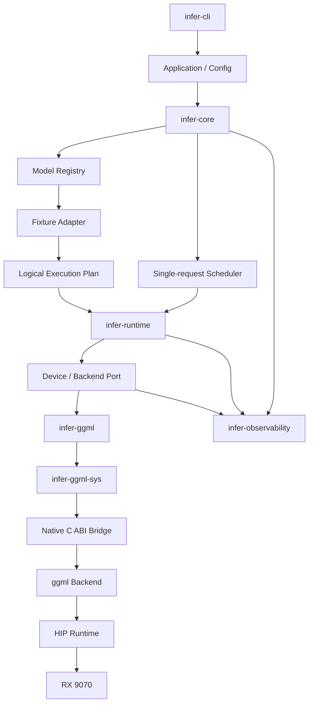
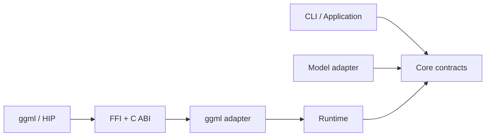
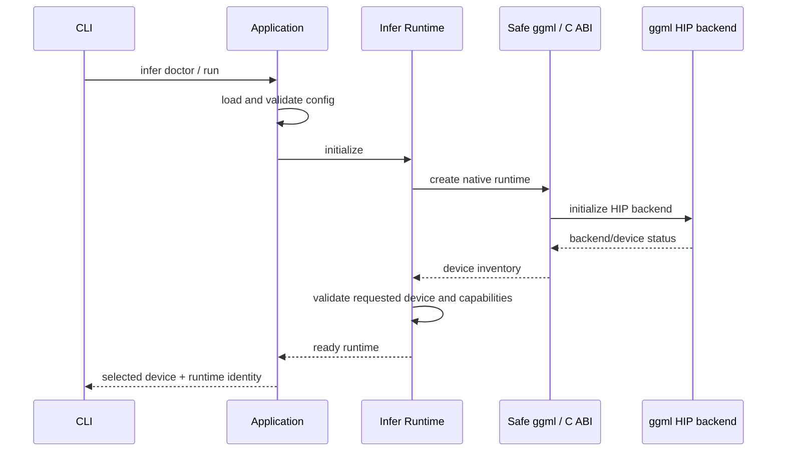
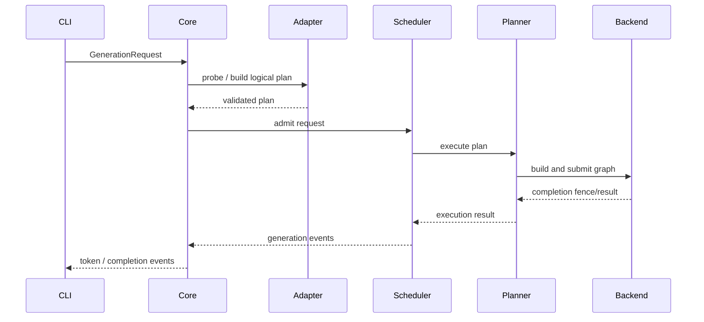

# Infer — Phase 1 MVP Design

**Status:** Proposed implementation design  
**Version:** 0.1  
**Date:** 2026-11-26  
**Parent documents:** [Product Requirements](PRODUCT_REQUIREMENTS.md) · [Technical Requirements](TECHNICAL_REQUIREMENTS.md) · [Reference Architecture](REFERENCE_ARCHITECTURE.md)

---

## 1. Executive summary

Phase 1 delivers the **generic, model-neutral inference foundation** for Infer. It proves that a Rust application can discover and select the target AMD GPU, initialize a pinned ggml/llama.cpp HIP execution substrate through a narrow C ABI, build and execute a small deterministic model graph, stream generated tokens through a stable request interface, and report useful runtime telemetry.

Phase 1 is deliberately a foundation milestone, not the first complete Qwen3.8 runtime. It establishes the boundaries that later memory management, paged KV, recurrent-state handling, MoE expert residency and model-specific adapters will use.

### Phase 1 outcome

A user can run a native Ubuntu CLI command that:

1. reports the selected RX 9070 / gfx1201 device and runtime identity;
2. validates a model-neutral test model and its execution capabilities;
3. executes a deterministic graph using the selected ggml/HIP backend;
4. performs a small end-to-end generation-style request through the generic runtime;
5. receives incremental output and can cancel a request safely;
6. sees prefill/decode timing, device memory observations, execution status and build/runtime provenance;
7. exits cleanly without leaked native handles or outstanding work.

The first test model may be a small deterministic fixture or a deliberately small supported dense model. The fixture is the mandatory acceptance path; support for an external production model is an additional integration check, not a prerequisite for proving the runtime boundary.

### Explicit Phase 1 non-goals

- Qwen3.8-Flash-Next architecture execution.
- GSQ-RCO custom quantization or tensor types.
- MoE expert caching, expert prefetch or PLE streaming.
- Full paged attention KV with host spill.
- SSM/recurrent-state checkpointing or streaming.
- Transparent OS-like GPU virtual memory.
- General-purpose NVMe paging in the token path.
- MTP/speculative decoding.
- Multi-GPU, CUDA, Vulkan or Windows-native support.
- Concurrent multi-model serving, multi-tenant scheduling or dynamic third-party plugins.
- OpenAI-compatible HTTP serving API.

Phase 1 should not create throwaway interfaces for these features. It should establish only the contracts needed to add them without redesigning the core.

---

## 2. Goals, scope and success criteria

### 2.1 Goals

| ID | Goal | Evidence |
|---|---|---|
| P1G-01 | Establish a reproducible Rust + native build | Clean build instructions and recorded toolchain/revision |
| P1G-02 | Discover and explicitly select RX 9070 / gfx1201 | Device-inspection output and automated test |
| P1G-03 | Isolate native ggml/HIP behind a narrow C ABI | FFI lifecycle tests; no C++ types exposed to Rust |
| P1G-04 | Prove backend-neutral model/runtime contracts | Generic fixture adapter runs without model-specific branches in core |
| P1G-05 | Execute a graph on HIP and validate results | Deterministic output compared with CPU/reference result |
| P1G-06 | Provide a minimal request/generation lifecycle | Incremental events, bounded output, cancellation and clean completion |
| P1G-07 | Establish telemetry and provenance | Structured logs and machine-readable run summary |
| P1G-08 | Establish resource ownership and shutdown rules | Repeated load/run/unload tests without leaks or premature frees |

### 2.2 Phase 1 scope

**Included**
- Native Ubuntu Linux on the target RX 9070.
- Rust stable toolchain, with MSRV pinned when dependencies are selected.
- Cargo for Rust; CMake + Ninja for native components.
- Clang/AMD HIP toolchain for the native backend build.
- One process, one host, one selected GPU, one active model/session.
- One selected and pinned ggml/llama.cpp revision.
- Minimal C ABI shim and safe Rust wrapper.
- Device discovery and capability validation.
- Generic model adapter contract and test fixture.
- Basic execution plan and graph submission.
- Basic request lifecycle, token/event streaming and cancellation.
- Initial memory accounting for allocations owned by Phase 1.
- Structured logging, timing and runtime identity.
- Automated unit, integration, failure and smoke tests.

**Not included**
- Complete global multi-class residency coordination and eviction policies.
- Host-backed KV pages or asynchronous KV spill/restore.
- Production long-context admission control.
- Resource-specific expert/PLE/recurrent-state policies.
- Advanced overlap, prefetch and cache optimization.

The initial memory accounting is not a substitute for the later global memory coordinator. It exists to make Phase 1 allocations visible and ownership-safe.

### 2.3 Definition of done

Phase 1 is complete only when all of the following are true:

1. A clean checkout builds from documented instructions on the target Ubuntu environment.
2. The requested HIP device is found by stable identity and validated as gfx1201; a missing or mismatched device produces a clear error rather than silently selecting another GPU.
3. Rust can create, use and destroy the native runtime through the C ABI.
4. A generic fixture adapter can construct a logical execution plan without importing HIP or ggml implementation details.
5. The HIP backend executes a representative graph and returns finite, deterministic results within defined tolerance.
6. A request can emit incremental output, stop at a configured limit, be cancelled, and release resources safely.
7. Logs and a run summary identify the model fixture, backend, GPU, runtime versions, source revisions, configuration and timings.
8. Tests cover failure during initialization, graph submission, cancellation and shutdown.
9. Repeated runs do not cause unbounded host/GPU allocation growth or stale-handle errors.
10. Phase 1 limitations are explicit in CLI help and documentation.

No tokens-per-second target is set in this phase. Performance baselines must be collected only after correctness, build identity and workload are reproducible.

---

## 3. User workflow and command surface

Keep the first interface CLI-only. The CLI is a thin application layer over the same Rust core that a future HTTP server can call.

### 3.1 Commands

Proposed command surface (names may be adjusted during implementation, but semantics should remain stable):

| Command | Responsibility |
|---|---|
| `infer doctor` | Validate host prerequisites, native runtime, HIP availability and selected device |
| `infer devices` | List discovered compute devices and capabilities |
| `infer config validate --config <path>` | Parse, validate and print effective configuration |
| `infer model inspect --model <path>` | Inspect supported metadata or report unsupported format/features |
| `infer test run --fixture <name>` | Run deterministic backend and adapter integration tests |
| `infer run --fixture <name> --prompt <text>` | Execute the initial end-to-end request path |
| `infer benchmark --fixture <name>` | Run a repeatable smoke benchmark and emit a result record |

The fixture command is the mandatory Phase 1 vertical slice. `model inspect` must not imply that all GGUF architectures or quantization types can be executed.

### 3.2 Example operator flow

```text
$ infer doctor
  Host: Ubuntu ...
  HIP runtime: available
  ggml revision: <pinned revision>
  Device: AMD Radeon RX 9070
  Architecture: gfx1201
  Status: ready

$ infer test run --fixture tiny-dense
  Adapter: fixture.dense.v1
  Backend: ggml-hip
  Graph: passed
  Reference comparison: passed
  Result: PASS

$ infer run --fixture tiny-dense --prompt "Explain memory tiers"
  [streamed output...]
  request_id=... status=completed
  prefill_ms=... decode_ms=... tokens=...
```

The values above illustrate the intended output shape; they are not measured results.

---

## 4. Architecture overview

### 4.1 Logical component diagram



### 4.2 Ownership boundaries

| Component | Phase 1 responsibility | Must not do |
|---|---|---|
| CLI / application | Parse commands/config, initialize runtime, print output, map errors to exit codes | Implement model math or own native pointers |
| Core | Request lifecycle, generation events, cancellation and session identity | Call HIP or allocate device buffers directly |
| Model contract | Identify architecture, validate metadata, describe capabilities and create logical plan | Select device, allocate VRAM or choose backend |
| Fixture adapter | Provide deterministic test topology and reference behavior | Add fixture-specific branches to core |
| Scheduler | Admit one request, order work, enforce output limits and cancellation | Replace ggml graph scheduler or execute kernels |
| Runtime / planner | Validate plan requirements, bind execution operations and track completion | Parse model files or implement architecture math |
| Device/backend port | Report capabilities and execute supported graph operations | Own product-level request policy |
| Safe ggml wrapper | RAII-style ownership of opaque native handles, typed operations and completion objects | Expose raw pointers to general core code |
| Raw FFI crate | Declare C ABI functions and opaque handle types | Contain product policy |
| Native bridge | Adapt pinned ggml/backend APIs to stable C functions | Leak C++ classes, exceptions or STL types |
| Observability | Collect structured events, metrics and provenance | Mutate scheduling/memory policy |

### 4.3 Dependency direction



The dependency rule is more important than the exact crate count: product and model logic must not depend on HIP APIs or unstable ggml internals. Native implementation changes should be contained behind the bridge and safe wrapper.

---

## 5. Proposed workspace and source layout

Start with a small modular monolith. Do not create a crate for every folder.

```text
Infer/
  Cargo.toml
  Cargo.lock
  rust-toolchain.toml
  .cargo/
    config.toml
  crates/
    infer-cli/
      src/
        main.rs
        commands/
    infer-core/
      src/
        request.rs
        generation.rs
        model.rs
        error.rs
    infer-model/
      src/
        adapter.rs
        capabilities.rs
        registry.rs
        plan.rs
    infer-model-fixture/
      src/
        lib.rs
    infer-runtime/
      src/
        runtime.rs
        scheduler.rs
        executor.rs
        device.rs
    infer-ggml-sys/
      build.rs
      src/
        lib.rs
    infer-ggml/
      src/
        lib.rs
        context.rs
        backend.rs
        buffer.rs
        graph.rs
        event.rs
    infer-observability/
      src/
        events.rs
        metrics.rs
        logging.rs
    infer-testkit/
      src/
        reference.rs
        fixtures.rs
  native/
    ggml-bridge/
      CMakeLists.txt
      include/
        infer_ggml_bridge.h
      src/
        infer_ggml_bridge.cpp
  config/
    default.toml
  tests/
    integration/
  benchmarks/
  docs/
```

Crate boundaries can be collapsed if early implementation demonstrates that separate crates add friction without protecting ownership or portability. The raw FFI crate and native bridge should remain isolated.

### 5.1 Dependency policy

- Pin Rust toolchain and crate dependencies through `rust-toolchain.toml` and `Cargo.lock`.
- Pin ggml/llama.cpp to a full commit SHA, not a moving branch or tag.
- Record any local patches as small, reviewable patch files with rationale.
- Build native code with CMake/Ninja and the intended Clang/HIP toolchain.
- Avoid adding a second tensor framework or Python runtime to the inference process.
- Keep build scripts deterministic and fail when required HIP support is absent; do not silently build a CPU-only binary when the user requested HIP.

The exact ggml revision and bridge API are implementation gates. They must be selected by inspecting the current upstream source and validating the target HIP backend before implementation is treated as stable.

---

## 6. Core contracts and data model

The following is conceptual Rust, not a frozen public API. Names and generic bounds can be refined during implementation. Keep contracts small and based on demonstrated change boundaries.

### 6.1 Identifiers and errors

```rust
#[derive(Clone, Debug, Eq, PartialEq, Hash)]
pub struct RequestId(pub String);

#[derive(Clone, Debug, Eq, PartialEq, Hash)]
pub struct ModelArchitectureId(pub String);

#[derive(Debug, thiserror::Error)]
pub enum InferError {
    #[error("configuration invalid: {0}")]
    InvalidConfig(String),
    #[error("device unavailable: {0}")]
    DeviceUnavailable(String),
    #[error("unsupported capability: {0}")]
    Unsupported(String),
    #[error("model validation failed: {0}")]
    ModelInvalid(String),
    #[error("backend failure: {0}")]
    Backend(String),
    #[error("request cancelled")]
    Cancelled,
    #[error("resource lifecycle failure: {0}")]
    Resource(String),
}
```

Use structured error variants and stable error codes at the application boundary. Avoid string matching to determine recovery behavior.

### 6.2 Device capabilities

```rust
pub struct DeviceInfo {
    pub id: DeviceId,
    pub name: String,
    pub architecture: String,
    pub total_memory_bytes: u64,
    pub free_memory_bytes: Option<u64>,
    pub capabilities: DeviceCapabilities,
    pub backend: BackendId,
}

pub struct DeviceCapabilities {
    pub supports_fp16: bool,
    pub supports_bf16: bool,
    pub supported_buffer_types: Vec<BufferTypeId>,
    pub supported_operations: OperationSet,
}
```

Capability fields must be based on backend/runtime evidence. Unknown values remain unknown; do not infer support from the GPU product name.

Device selection should accept an explicit stable backend identifier and optionally an ordinal for convenience. The selected device identity and selection reason must be logged. If the requested device cannot be selected, return an actionable error.

### 6.3 Model adapter

```rust
pub trait ModelAdapter: Send + Sync {
    fn id(&self) -> ModelArchitectureId;
    fn probe(&self, metadata: &ModelMetadata) -> ProbeResult;
    fn capabilities(&self) -> ModelCapabilities;
    fn build_plan(
        &self,
        metadata: &ModelMetadata,
        request: &ModelRequest,
    ) -> Result<LogicalExecutionPlan, InferError>;
}
```

Phase 1 uses a fixture adapter. The contract must not include HIP handles, ggml pointers, device allocation methods or model-family conditionals. The adapter describes logical operations and requirements; the runtime resolves them against the selected backend.

The first contract should cover only what the fixture requires. Do not prematurely encode every future Qwen3.8 feature into a large generic schema. Extend capabilities when a real adapter requires them.

### 6.4 Execution plan

An execution plan is a model-neutral description of work. It should be inspectable and testable without a GPU.

Conceptual shape:

```rust
pub struct LogicalExecutionPlan {
    pub architecture: ModelArchitectureId,
    pub operations: Vec<LogicalOperation>,
    pub required_capabilities: OperationSet,
    pub resource_requirements: Vec<ResourceRequirement>,
}
```

The initial fixture plan should use a small, known operation set supported by the pinned backend. It must be possible to validate the plan before graph submission.

### 6.5 Request and generation events

```rust
pub struct GenerationRequest {
    pub request_id: RequestId,
    pub model_id: String,
    pub prompt: String,
    pub max_new_tokens: u32,
}

pub enum GenerationEvent {
    Started { request_id: RequestId },
    PrefillCompleted { elapsed: Duration },
    Token { token_id: u32, text: String },
    Metrics(GenerationMetrics),
    Completed,
    Cancelled,
    Failed(InferError),
}
```

A future HTTP API can consume the same event stream. Do not tie the core event model to HTTP/SSE types.

Phase 1 fixture generation can be deterministic. Its purpose is to validate the runtime and lifecycle, not to demonstrate language-model quality.

---

## 7. Native interoperability design

### 7.1 Boundary

Rust must not bind directly to broad, unstable C++ internals. A small native bridge wraps only the ggml operations required by Phase 1.

```text
Rust application
  |
  v
infer-ggml safe wrapper
  |
  v
infer-ggml-sys (opaque C declarations)
  |
  v
infer_ggml_bridge.h / .cpp
  |
  v
pinned ggml backend + HIP implementation
```

### 7.2 C ABI principles

- Expose opaque handles such as `infer_runtime_t`, `infer_device_t`, `infer_buffer_t`, `infer_graph_t` and `infer_event_t`.
- Expose plain C-compatible structs with explicit size/version fields where ABI evolution is expected.
- Use explicit create/destroy functions and document the owner of every handle.
- Return status codes; provide a bounded error-message retrieval function.
- Catch all C++ exceptions inside the bridge and translate them to status codes.
- Prevent Rust panics from crossing into native code.
- Do not expose C++ classes, templates, STL containers, references or exceptions.
- Do not return borrowed pointers whose lifetime cannot be represented safely.
- Keep raw pointers and unsafe blocks inside `infer-ggml-sys` and the safe wrapper implementation.

Illustrative header:

```c
typedef struct infer_runtime infer_runtime_t;
typedef struct infer_device infer_device_t;
typedef struct infer_graph infer_graph_t;
typedef struct infer_event infer_event_t;

typedef struct {
    uint32_t struct_size;
    uint32_t api_version;
    char name[128];
    char architecture[32];
    uint64_t total_memory_bytes;
    uint64_t free_memory_bytes;
} infer_device_info_t;

int32_t infer_runtime_create(
    const infer_runtime_config_t* config,
    infer_runtime_t** out_runtime);

int32_t infer_runtime_get_device_count(
    infer_runtime_t* runtime,
    uint32_t* out_count);

int32_t infer_runtime_get_device_info(
    infer_runtime_t* runtime,
    uint32_t index,
    infer_device_info_t* out_info);

int32_t infer_runtime_destroy(infer_runtime_t* runtime);
```

This is an interface sketch only. The exact functions must be derived from the pinned ggml revision and the minimal graph operations Phase 1 needs.

### 7.3 Safe wrapper ownership

- Rust wrapper types own their opaque handles and destroy them exactly once.
- Prefer non-cloneable owners; expose shared access through references or explicitly reference-counted handles only where needed.
- Graph submission returns a completion object/fence.
- Buffers and graph resources remain alive until completion is observed.
- Shutdown waits for or safely drains owned work before destroying backend/context handles.
- A failed native call must not leave Rust ownership state ambiguous.

### 7.4 Native build integration

Use CMake/Ninja for the bridge and pinned ggml build. Cargo's build script should:
1. locate the configured native source/build directory;
2. invoke or consume the reproducible CMake build;
3. link the bridge and required native libraries;
4. emit clear diagnostics when HIP compiler/runtime dependencies are missing;
5. record the selected backend and native revision in build metadata.

Do not hardcode local absolute paths. Support explicit environment/config overrides for ROCm and the native source checkout.

---

## 8. Execution flow

### 8.1 Startup



Startup must fail early if the selected device is absent, the requested backend is not compiled, or required capabilities are missing.

### 8.2 Request execution



The fixture adapter may generate a known sequence from deterministic graph results. The same request lifecycle will later be backed by tokenizer, sampler and autoregressive model execution.

### 8.3 Cancellation and shutdown

Cancellation is a request to stop producing further work, not permission to free resources immediately.

1. Mark the request cancellation token.
2. Stop admitting new graph segments for that request.
3. Allow already-submitted GPU work to reach a safe completion/cancellation boundary.
4. Retain graph and buffer ownership until the backend fence is complete.
5. Release request-owned resources.
6. Emit exactly one terminal event: completed, cancelled or failed.

Shutdown follows reverse ownership order: stop admission → drain/cancel requests → wait for owned completion fences → release graph/buffer objects → destroy backend/context → exit process.

---

## 9. Phase 1 memory model

Phase 1 implements **safe accounting for its own active allocations**, not the complete tiered memory product capability.

### 9.1 Included

- Query total/free device memory where the backend exposes reliable values.
- Record allocation size, category, owner and lifetime for Infer-created native buffers.
- Track allocations and releases in the runtime.
- Reserve a configurable safety margin before allocating Phase 1 workspaces/buffers.
- Fail allocation requests cleanly when the budget cannot be satisfied.
- Ensure buffers are not released before graph completion.
- Report measured device totals separately from Infer-owned allocation totals.

### 9.2 Deferred

- Global arbitration across experts, KV, recurrent state, PLE, weights and workspace.
- Pinned host memory pools and pageable-host resource management.
- File/mmap backing and host-device migration.
- Resource lease registry and generalized residency state machine.
- Paged KV block allocator, sequence-aware eviction and host spill.
- Expert-aware cache and transfer scheduler.

### 9.3 Important accounting semantics

Do not claim that `total VRAM - free VRAM` equals Infer allocations. Other processes, display use, driver allocations, backend pools and allocator caching may contribute. Telemetry must distinguish:
- device-reported total/free/used (where available);
- Infer-tracked live allocations;
- Infer reserved budget;
- configured safety reserve;
- unknown/external usage.

This prevents misleading memory numbers and prepares for the full coordinator.

---

## 10. Configuration design

Use a versioned TOML configuration with explicit effective-value reporting. Keep defaults conservative and avoid silently ignoring unsupported options.

Illustrative configuration:

```toml
schema_version = 1

[runtime]
backend = "ggml-hip"
device = "AMD Radeon RX 9070"
execution_mode = "single_request"
log_level = "info"

[native]
ggml_source = "./native/ggml"
build_dir = "./build/native"
cmake_generator = "Ninja"

[memory]
vram_budget_bytes = 0
safety_reserve_bytes = 0

[model]
adapter = "fixture.dense.v1"
path = ""

[generation]
max_new_tokens = 64
```

The zero values above mean “derive from detected capabilities using a documented policy” only if that behavior is explicitly implemented; otherwise validation must reject them and require a concrete value. Do not leave ambiguous sentinel semantics in the final schema.

Configuration requirements:
- Validate unknown keys and unsupported enum values.
- Print effective values and the source of each value (default, config, CLI or detected).
- Never silently switch the backend or device.
- Avoid storing secrets; Phase 1 has no remote service credentials.
- Include schema version and migration strategy before future breaking changes.

---

## 11. Observability and diagnostics

### 11.1 Structured events

Use structured logs with stable fields:
- timestamp;
- severity;
- event name;
- request ID where relevant;
- component;
- error code;
- elapsed duration;
- backend and device identity.

### 11.2 Minimum metrics

| Metric | Meaning |
|---|---|
| startup duration | Process start to runtime-ready |
| device discovery duration | Time to enumerate/validate devices |
| graph build duration | Logical/native graph preparation |
| graph execution duration | Backend execution time |
| prefill duration | Fixture/request input stage |
| decode duration | Output-generation stage |
| generated item count | Tokens/events emitted |
| device total/free memory | Backend/driver observation |
| Infer live allocation bytes | Tracked allocations owned by Infer |
| allocation failures | Failed allocation count and reason |
| request terminal status | Completed/cancelled/failed |
| native/backend identity | Exact revision and runtime details |

Phase 1 can report token timing only where the fixture produces token-like events. Do not present fixture throughput as a production LLM tokens-per-second benchmark.

### 11.3 Run manifest

Every test and benchmark record should include:
- Infer git commit and dirty-tree status;
- Rust compiler and target;
- OS/kernel;
- ROCm/HIP runtime and driver versions;
- GPU name and architecture;
- ggml/llama.cpp commit and local patch identifiers;
- build flags and backend enabled state;
- fixture/model identity and content hash where applicable;
- configuration hash and effective configuration;
- workload size, warm/cold state and repetition count.

Write machine-readable JSONL records initially. Keep metrics local; no network reporting or prompt upload.

---

## 12. Error handling and failure policy

| Failure | Required behavior |
|---|---|
| HIP runtime unavailable | Fail startup with prerequisite diagnostics |
| Requested device missing | Fail; do not silently select another device |
| Architecture mismatch | Fail before model/graph allocation |
| ggml revision/build mismatch | Fail or report explicit unsupported build; never guess ABI compatibility |
| Unsupported graph operation | Reject plan before submission where discoverable |
| Native allocation failure | Return structured error; roll back tracked reservation |
| Graph execution failure | Mark request failed; retain resources until safe cleanup |
| Cancellation during execution | Drain outstanding work and release only after completion |
| Telemetry provider unavailable | Mark field unavailable; do not fabricate zero |
| Shutdown with outstanding work | Drain safely or return a clear shutdown failure; never free in-use memory |

Errors should include the failing component and actionable context, but must not dump unbounded native logs or sensitive prompt content.

---

## 13. Testing strategy

Testing is layered so most correctness checks do not require the GPU.

### 13.1 Unit tests (CPU-only)

- Config parsing, validation and effective-value precedence.
- Device selection logic with fake device inventories.
- Adapter probe and capability matching.
- Logical plan validation.
- Request state transitions and terminal-event uniqueness.
- Cancellation token behavior.
- Memory accounting arithmetic and reservation rollback.
- Error-code mapping and run-manifest serialization.

### 13.2 Native/FFI tests

- Create/destroy runtime repeatedly.
- Enumerate devices and inspect capability fields.
- Validate null pointer, invalid index and invalid config handling.
- Verify native errors become Rust errors.
- Verify no exception/panic crosses the ABI.
- Verify handles are destroyed exactly once.

### 13.3 GPU integration tests

- Run a small deterministic operation graph on RX 9070.
- Compare GPU result with a CPU/reference implementation within operation-specific tolerance.
- Test supported data types individually; do not infer BF16/FP16 support from device identity alone.
- Verify graph completion fences and buffer lifetime.
- Force allocation failure using a controlled small budget where practical.
- Repeat graph execution and check for unbounded allocation growth.

### 13.4 Lifecycle and stress tests

- Repeated initialize → execute → shutdown cycles.
- Cancellation before graph submission.
- Cancellation after graph submission but before completion.
- Backend error during graph execution.
- Shutdown with outstanding completion fence.
- Repeated requests with bounded output.
- Verify every request emits exactly one terminal event.

### 13.5 Acceptance matrix

| ID | Test | Pass condition |
|---|---|---|
| P1-VT-01 | Clean build | Reproducible documented build succeeds |
| P1-VT-02 | Device discovery | RX 9070 / gfx1201 correctly identified |
| P1-VT-03 | Explicit selection | Missing/mismatched device fails without fallback |
| P1-VT-04 | FFI lifecycle | Native handles create/destroy safely over repeated cycles |
| P1-VT-05 | Generic adapter | Fixture plan validates without core model-family conditionals |
| P1-VT-06 | HIP graph | GPU result matches reference within declared tolerance |
| P1-VT-07 | Streaming lifecycle | Incremental events and bounded output work |
| P1-VT-08 | Cancellation | No use-after-free; one terminal cancellation event |
| P1-VT-09 | Memory accounting | Infer-owned allocations reconcile after request/shutdown |
| P1-VT-10 | Telemetry | Run manifest contains required identity and timing fields |
| P1-VT-11 | Failure recovery | Native/backend failures return structured errors and clean up |
| P1-VT-12 | Repeatability | Repeated runs do not show unbounded resource growth |

---

## 14. Implementation work packages

Deliver in small increments. Each work package should have tests and a reviewable commit.

### WP-0 — Repository and build baseline
- Add Rust workspace, pinned toolchain and formatting/lint configuration.
- Add native source strategy and build scripts.
- Select and pin ggml/llama.cpp commit after source/API inspection.
- Record compiler, ROCm/HIP and CMake/Ninja prerequisites.
- Add `infer --version` with source revision/build identity.

**Exit:** clean checkout can build a minimal CLI and native bridge.

### WP-1 — Native device discovery
- Implement minimal C ABI runtime initialization and device enumeration.
- Add safe Rust wrappers and explicit handle ownership.
- Validate selected RX 9070 / gfx1201.
- Add `infer doctor` and `infer devices`.

**Exit:** CLI reports the correct target device and fails safely for invalid selection.

### WP-2 — Model-neutral contracts
- Implement model metadata, adapter registry, capabilities and logical plan.
- Add deterministic fixture adapter.
- Add plan validation independent of GPU.
- Keep model and backend dependencies one-way.

**Exit:** fixture plan is testable on CPU and contains no native handles.

### WP-3 — Graph execution vertical slice
- Extend the C ABI only for the graph/buffer operations needed by the fixture.
- Implement safe graph, buffer and completion wrappers.
- Submit graph to HIP backend.
- Compare output to CPU/reference result.

**Exit:** deterministic GPU graph execution passes on RX 9070.

### WP-4 — Request lifecycle and streaming
- Add single-request scheduler and bounded output.
- Emit generation events.
- Implement cancellation and safe drain semantics.
- Add deterministic fixture generation.

**Exit:** request completes/cancels correctly and releases resources only after backend completion.

### WP-5 — Telemetry, diagnostics and hardening
- Add structured logs, run manifest and minimum metrics.
- Add allocation accounting and safety reserve.
- Add lifecycle/failure/stress tests.
- Document limitations and reproducible commands.

**Exit:** all Phase 1 acceptance tests pass on the target environment.

---

## 15. Key design decisions and unresolved questions

### Decisions for Phase 1

1. **Rust owns product logic.** Native C++ is restricted to the bridge and selected ggml/backend implementation.
2. **ggml remains the compute substrate.** Infer does not reimplement quantized kernels in this phase.
3. **Generic fixture first.** Prove adapter and runtime contracts before implementing Qwen3.8.
4. **One active request.** Keep scheduling deterministic; asynchronous backend completion remains supported.
5. **CLI first.** The core event model must not depend on a transport protocol.
6. **Explicit device selection.** No silent GPU fallback.
7. **Correctness before overlap.** No performance optimization that weakens resource lifetime guarantees.
8. **Accounting before paging.** Phase 1 tracks allocations; generalized tiered residency is a later work package.

### Must be resolved before or during WP-0/WP-1

- Exact ggml/llama.cpp commit to pin.
- Whether the selected revision exposes the required HIP device discovery, graph, buffer and event APIs without invasive patches.
- Minimal C ABI surface required by the fixture graph.
- HIP build flags and target architecture settings for gfx1201.
- Which device memory metrics are reliably available through the selected backend/runtime.
- Supported operation and datatype set for the deterministic fixture.
- Rust MSRV and dependency choices.

These are evidence-gathering tasks, not reasons to pre-design a broad abstraction layer. Record decisions as ADRs when evidence is available.

---

## 16. Risks and mitigations

| Risk | Impact | Mitigation |
|---|---|---|
| ggml internal APIs change | Native bridge maintenance | Pin commit; isolate internals; test bridge; keep patch set small |
| HIP backend operation coverage is incomplete | Fixture graph cannot execute | Select fixture operations only after testing pinned backend support |
| Native ownership bugs | Crashes or GPU use-after-free | Opaque handles, RAII wrappers, completion fences and stress tests |
| Device identity/ordinal instability | Wrong GPU selected | Match stable backend identity and architecture; log selection |
| Driver memory differs from Infer accounting | Misleading memory reports | Report driver observations and Infer allocations separately |
| Over-generalized model contracts | Slow implementation and brittle APIs | Implement fixture needs first; extend on real model evidence |
| Premature memory paging | Scope and correctness risk | Defer full residency manager and paged KV to subsequent phase |
| Fixture mistaken for production inference | Misleading expectations | Label fixture output and metrics explicitly; no LLM quality claims |

---

## 17. Handoff to Phase 2

Phase 1 creates the foundation; Phase 2 should build the **memory core** on top of it.

Phase 2 entry conditions:
- stable device/backend abstraction;
- safe native buffer ownership and completion fences;
- tested request cancellation and shutdown;
- model-neutral resource requirement descriptions;
- observable allocation accounting.

Phase 2 should then implement:
1. global memory coordinator and reservation/rollback;
2. explicit VRAM, pinned-host, pageable-host and file-backed tiers;
3. resource registry, residency state machine and leases;
4. async transfer tickets and bounded staging;
5. failure recovery and eviction safety;
6. generic paged-KV contract and tests.

Qwen3.8-specific hybrid attention/SSM, MoE, PLE and GSQ-RCO support should follow only after the generic memory lifecycle is validated. The exact Qwen3.8 artifact, tokenizer/template assets and custom tensor types must be inspected independently; model-family names or filenames are not sufficient evidence.

---

## 18. Phase 1 engineering guardrails

- Keep the implementation a modular monolith.
- Do not add dynamic plugin loading; compile-time adapter registration is sufficient.
- Do not introduce a generic scheduler framework for a single active request.
- Do not create a universal memory abstraction before resource classes and lifetimes are understood.
- Do not add custom HIP kernels unless the pinned ggml backend cannot provide a required operation and the need is demonstrated.
- Do not use device-wide synchronization as a routine substitute for completion dependencies.
- Do not equate host RAM with VRAM.
- Do not perform file/NVMe reads in the ordinary token-critical path.
- Do not add Qwen3.8 conditionals to core contracts.
- Do not publish performance claims from fixture workloads.
- Every abstraction must protect a real change boundary or test seam.

**Phase 1 principle:** prove one narrow, complete, observable execution path; preserve the boundaries needed to grow it; defer everything that is not required to prove that path.
